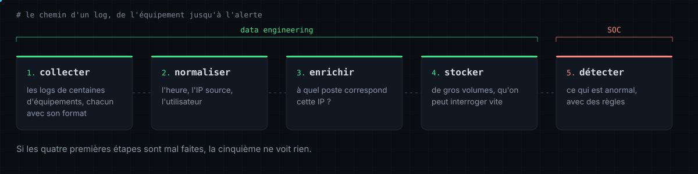

<picture><source media="(prefers-color-scheme: light)" srcset="assets/hero-light.svg"></picture>

[`./portfolio`](https://belemsigri-windyam-juste-yannel.vercel.app) &nbsp; [`./linkedin`](https://www.linkedin.com/in/windyam-juste-yannel-belemsigri) &nbsp; [`./mail`](mailto:yannelbelemsigri9@gmail.com)

### `01.` about

Salut ! Je suis en 2ᵉ année du cycle ingénieur à l'ENSA Kénitra, en génie informatique option Big Data & Data Science, après un DUT à l'EST Fès.

À côté des cours je suis le parcours Cisco CyberOps, je fais des labs sur TryHackMe, Hack The Box et OverTheWire, et je me forme avec Oracle sur les bases de données.

### `02.` ma façon de voir le métier

<picture><source media="(prefers-color-scheme: light)" srcset="assets/pipeline-light.svg"></picture>

### `03.` comment je travaille

- Avant d'écrire du code, je regarde les données à la main. Pour mes logs SSH, `grep`, `cut`, `sort` et `uniq` m'ont montré les pièges avant que le parser tombe dedans.
- Je code un algo moi-même avant de laisser une bibliothèque le faire à ma place.
- Quand j'hésite entre deux solutions, je mesure au lieu de deviner.
- Je n'écris un write-up qu'une fois le challenge résolu tout seul.
- Je note ce qui a coincé et comment je m'en suis sorti, pour m'en souvenir.

### `04.` stack

<picture><source media="(prefers-color-scheme: light)" srcset="assets/stack-light.svg"></picture>
