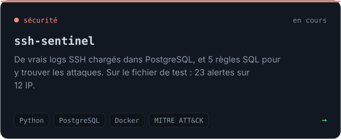
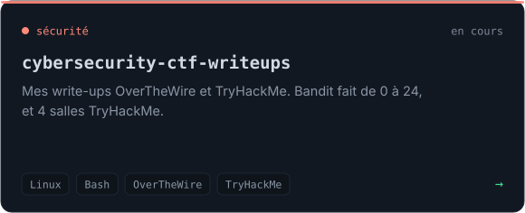
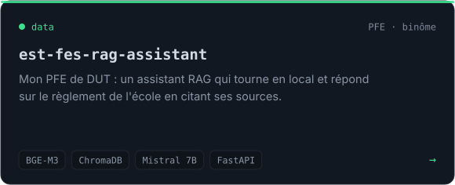
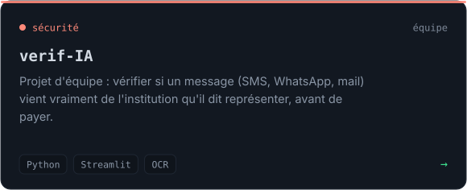
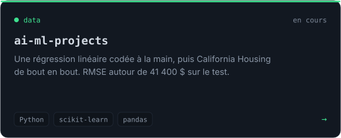
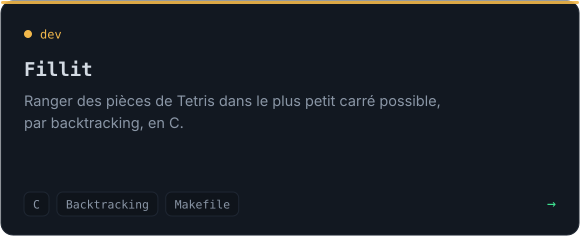
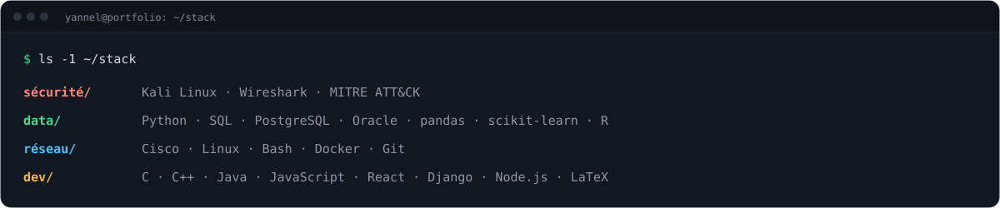

<picture><source media="(prefers-color-scheme: light)" srcset="assets/hero-light.svg"></picture>

[`./portfolio`](https://belemsigri-windyam-juste-yannel.vercel.app) &nbsp; [`./linkedin`](https://www.linkedin.com/in/windyam-juste-yannel-belemsigri) &nbsp; [`./mail`](mailto:yannelbelemsigri9@gmail.com)

### `01.` about

Salut, moi c'est Yannel. Je suis en 2ᵉ année du cycle ingénieur à l'ENSA Kénitra, en génie informatique option Big Data & Data Science, après un DUT à l'EST Fès.

Je vais vers la sécurité défensive. Avec ssh-sentinel j'ai vu qu'une bonne partie du travail se joue avant l'alerte : si les logs sont mal collectés ou mal découpés, la meilleure règle de détection ne sert à rien. Du coup j'apprends les deux en même temps, le SOC et le data engineering.

À côté des cours je suis le parcours Cisco CyberOps, je fais des labs sur TryHackMe, Hack The Box et OverTheWire, et je me forme avec Oracle sur les bases de données.

Si tu as un stage en SOC ou en data engineering, un lab à me conseiller ou une question sur un projet, écris-moi : mail ou LinkedIn, les liens sont en haut.

### `02.` projets

<a href="https://github.com/Windyam-Juste-Yannel-BELEMSIGRI/ssh-sentinel"><picture><source media="(prefers-color-scheme: light)" srcset="assets/card-ssh-sentinel-light.svg"></picture></a> <a href="https://github.com/Windyam-Juste-Yannel-BELEMSIGRI/cybersecurity-ctf-writeups"><picture><source media="(prefers-color-scheme: light)" srcset="assets/card-ctf-writeups-light.svg"></picture></a>

<a href="https://github.com/Windyam-Juste-Yannel-BELEMSIGRI/est-fes-rag-assistant"><picture><source media="(prefers-color-scheme: light)" srcset="assets/card-rag-light.svg"></picture></a> <a href="https://github.com/Windyam-Juste-Yannel-BELEMSIGRI/verif-IA"><picture><source media="(prefers-color-scheme: light)" srcset="assets/card-verif-ia-light.svg"></picture></a>

<a href="https://github.com/Windyam-Juste-Yannel-BELEMSIGRI/ai-ml-projects"><picture><source media="(prefers-color-scheme: light)" srcset="assets/card-ai-ml-light.svg"></picture></a> <a href="https://github.com/Windyam-Juste-Yannel-BELEMSIGRI/C_Projects"><picture><source media="(prefers-color-scheme: light)" srcset="assets/card-fillit-light.svg"></picture></a>

Le reste (labs réseau, Linux, cloud, ma roadmap) est dans mes dépôts, la plupart sont encore en train de se remplir.

### `03.` stack

<picture><source media="(prefers-color-scheme: light)" srcset="assets/stack-light.svg"></picture>
